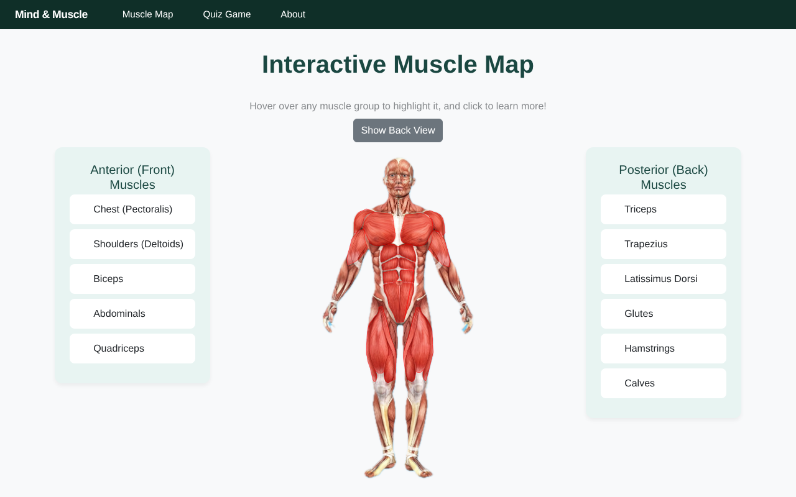
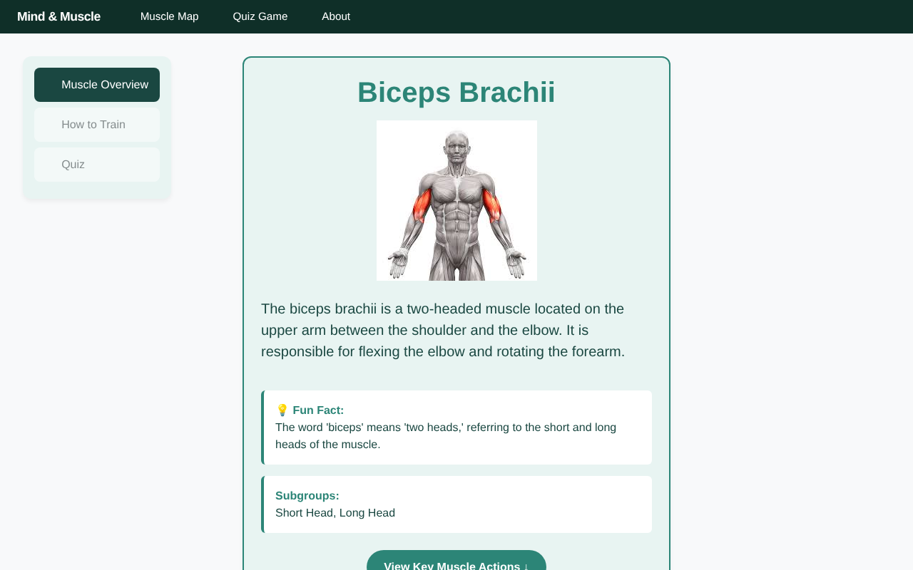
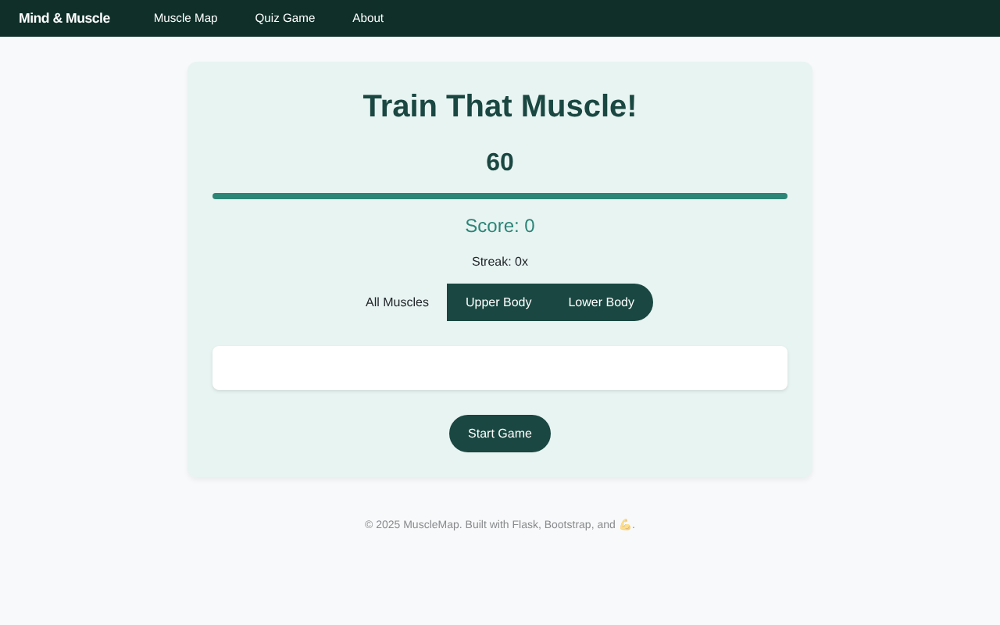

# MuscleMap

An interactive anatomy learning app built by Nick Felix, Mitchell Rosenthal, Jonathan Wrenn, and Shaya Schwarz. The interface also uses the name **Mind & Muscle**.

Explore the front and back of a muscle map, open guided muscle lessons, and practice with quizzes and a timed training game.

**Live site: [mitchrosenthal.github.io/MuscleMap](https://mitchrosenthal.github.io/MuscleMap/)**



| Muscle lesson | Quiz game |
| --- | --- |
|  |  |

## Features

- Clickable muscle regions with front/back views.
- Muscle descriptions, movement demonstrations, and exercise information.
- Quiz questions and an interactive training game.
- Browser-based learning progress and a local game leaderboard.
- Responsive Flask templates styled with Bootstrap and custom CSS.

## Mitchell's contributions

The original commit history records Mitchell's work on clickable muscle regions, SVG outlines, the posterior map, front/back toggling, progress tracking, Flask routes, muscle content, and project documentation. This is a four-person team project; the retained history credits each contributor.

## Run locally

Requires Python 3.10 or newer for this documented setup.

```bash
python3 -m venv .venv
source .venv/bin/activate
python -m pip install -r requirements.txt
python -m flask --app server run --port 5001
```

On Windows, activate with `.venv\Scripts\activate` instead. Open http://127.0.0.1:5001. Stop with Ctrl+C.

No database, API key, or account is needed. Some styling resources are loaded from external CDNs, so full styling requires internet access.

## How it works

`server.py` defines Flask routes and renders Jinja templates. `muscle_data.py` and `quiz_questions.py` contain Python data structures; they are not a database service. JavaScript handles map interactions, quiz behavior, and browser-local progress.

- `templates/`: home, muscle map, lesson pages, quizzes, and about page.
- `static/js/script.js`: map interactions and browser progress.
- `static/js/`: lesson and quiz interactions.
- `static/images/` and `static/gifs/`: anatomy and movement assets.

Progress is local to a browser. Quiz answers are delivered to the browser; this is a learning tool, not a secure examination system.

## Deployment

The live site is a static build of the Flask app. `freeze.py` renders every page with Flask's test client and writes the result to `build/`; `.github/workflows/deploy.yml` runs it and publishes to GitHub Pages on every push to `main`. To build it yourself, run `python freeze.py`.

## Checks

Run `python -m unittest discover -s tests` to check public pages, linked muscle lessons, the standalone quiz, and unknown-muscle handling.

## Provenance

Originally developed in the private team repository `nicorox247/MuscleMap`. This copy preserves the original Git history.
